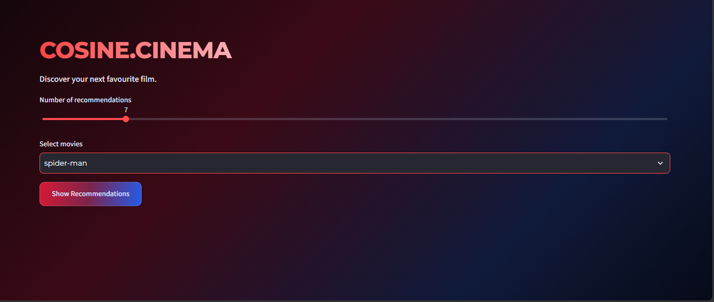
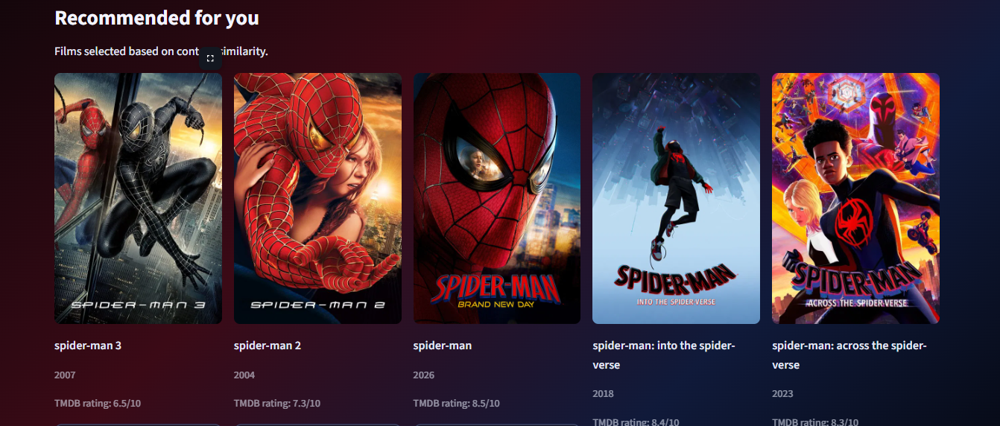
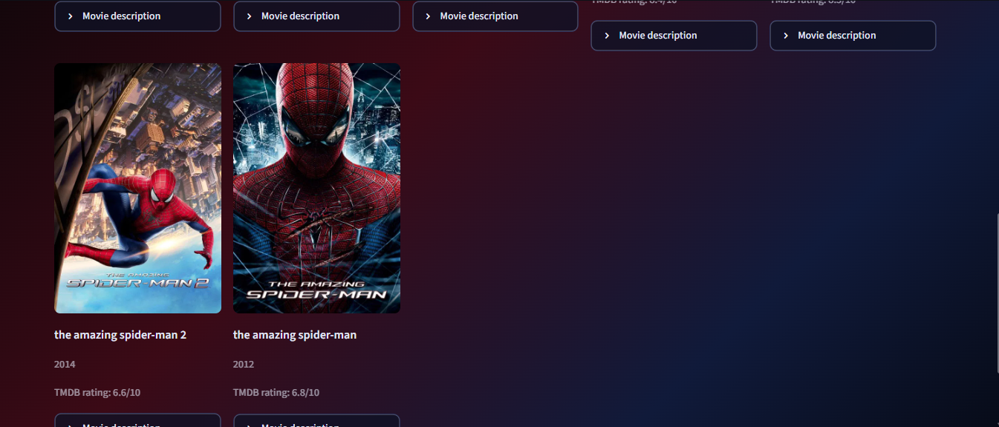

# COSINE.CINEMA — Content-Based Movie Recommender

COSINE.CINEMA is a content-based movie recommendation system built with Python and scikit-learn. It recommends five movies similar to a selected film by comparing textual features such as plot overview, genre, and crew.

The Streamlit application displays movie posters, descriptions, release years, and ratings using the TMDB API.

## Live Demo

**[Try COSINE.CINEMA](https://movierecommendationsystem-p3muw2rldv8zv4sqgaqnhq.streamlit.app/)**

## Screenshots


 



## Features

- Content-based recommendations using TF-IDF and cosine similarity.
- Five recommendations for a selected movie.
- Movie posters retrieved through the TMDB API.
- Movie descriptions, release years, and ratings.
- Streamlit interface with a dark cinematic theme.
- Cached movie-detail lookups to reduce repeated API requests.

## How It Works

1. **Feature preparation:** Movie overview, genre, and crew information are combined into a text representation for each movie.
2. **TF-IDF vectorization:** `TfidfVectorizer` transforms the text into a sparse numerical feature matrix.
3. **Similarity calculation:** Cosine similarity compares the selected movie's vector against the vectors of all movies.
4. **Recommendation ranking:** The five highest-ranked similar movies are returned, excluding the selected movie.
5. **Movie metadata:** The TMDB API supplies poster images, descriptions, release dates, and ratings for display.

The TF-IDF matrix is precomputed and saved. Similarity scores are calculated when a user selects a movie rather than storing a complete pairwise similarity matrix.

## Experiments and Findings

### TF-IDF vs. CountVectorizer

Both vectorization approaches produced broadly similar recommendations in the experiments. TF-IDF was retained as the final approach.

### Including Crew Information

Removing crew information reduced recommendation relevance in the tested examples. Crew information can help distinguish films through shared actors and directors.

### Data Alignment Bug

An early comparison incorrectly paired movie text with records because separately filtered DataFrames had mismatched indices. Correcting the alignment changed the comparison results.

This highlighted the importance of validating data alignment before drawing conclusions from model experiments.

*These observations are qualitative findings from development experiments, not results from a formal user study or comprehensive recommendation benchmark.*

## Tech Stack

- **Language:** Python
- **Data processing:** pandas
- **Machine learning:** scikit-learn
- **Text representation:** TF-IDF
- **Similarity metric:** Cosine similarity
- **Web application:** Streamlit
- **Movie metadata and posters:** TMDB API
- **Caching and HTTP requests:** Streamlit caching and requests

## Dataset

The project uses an IMDb movies dataset containing movie titles, genres, overviews, and crew information.

[View the dataset in this repository](https://github.com/JudeDavid15/Movie_Recommendation_System/blob/main/imdb_movies.csv)

## Project Structure

```text
Movie_Recommendation_System/
├── .streamlit/
│   └── secrets.toml          # Local API secrets: Ignored
├── screenshots/
│   ├── home.png
│   └── recommendations.png
├── movie.py                  # Streamlit application
├── movie.pkl                 # Preprocessed movie DataFrame
├── tfidf_matrix.pkl          # Precomputed TF-IDF matrix
├── movie_rec.ipynb           # Development and experiments
├── imdb_movies.csv           # Dataset
├── requirements.txt          # Python dependencies
├── .gitignore                # Excluded files and secrets
└── README.md
```

## Run Locally

### 1. Clone the repository

```bash
git clone https://github.com/JudeDavid15/Movie_Recommendation_System.git
cd Movie_Recommendation_System
```

### 2. Install dependencies

```bash
python -m pip install -r requirements.txt
```

### 3. Configure the TMDB API key

Create `.streamlit/secrets.toml`:

```toml
TMDB_API_KEY = "your_tmdb_api_key"
```

Never commit this file or expose your API key in public source code.

### 4. Start the application

```bash
python -m streamlit run movie.py
```

## Limitations

- Recommendations depend on the textual features represented in the TF-IDF matrix.
- The system does not learn user preferences from interactions or viewing history.
- Similarity scores measure textual similarity, not necessarily movie quality or individual preference.
- TMDB title searches may occasionally match the wrong movie when titles are ambiguous.
- Movie metadata and poster availability depend on the external API.

## Future Improvements

- Evaluate recommendation quality using a defined test set and ranking metrics.
- Improve movie matching using IMDb IDs where available.
- Add filtering by genre and release year.
- Compare TF-IDF recommendations with embedding-based retrieval.
- Add automated tests for recommendation ranking, data alignment, and API failures.

## Attribution

Movie metadata and poster images are retrieved from TMDB.

This product uses the TMDB API but is not endorsed or certified by TMDB.

## License

The original source code for CosineCinema is licensed under the [MIT License](LICENSE).

Third-party datasets, movie posters, and metadata are not covered by this license and remain subject to their respective owners' rights and applicable terms.

Movie posters and metadata are retrieved through the TMDB API. This product uses the TMDB API but is not endorsed or certified by TMDB.
